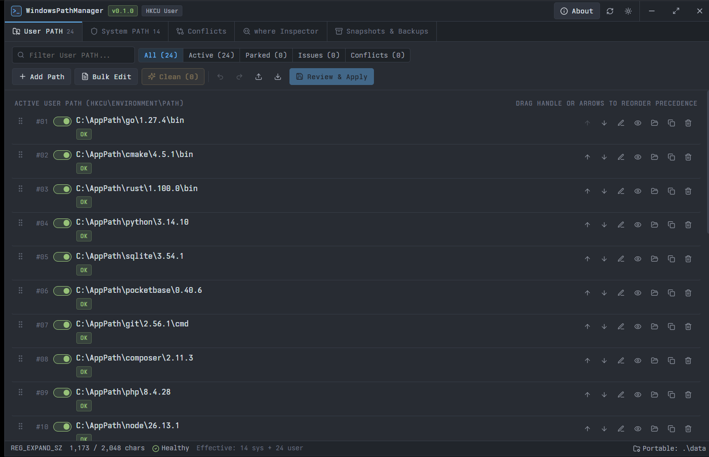
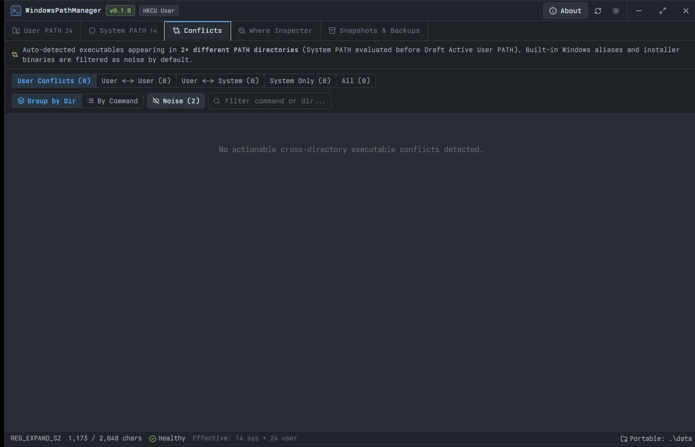
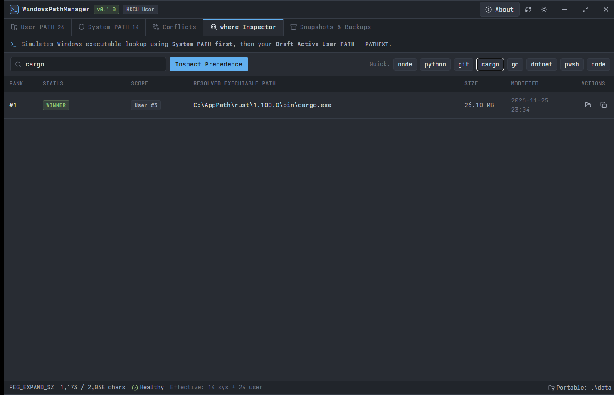
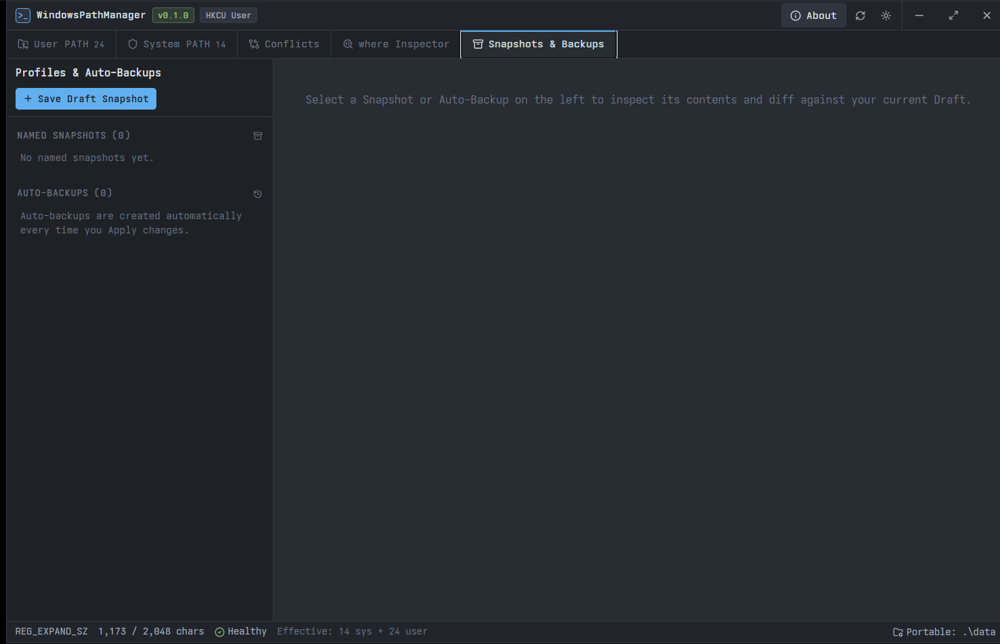
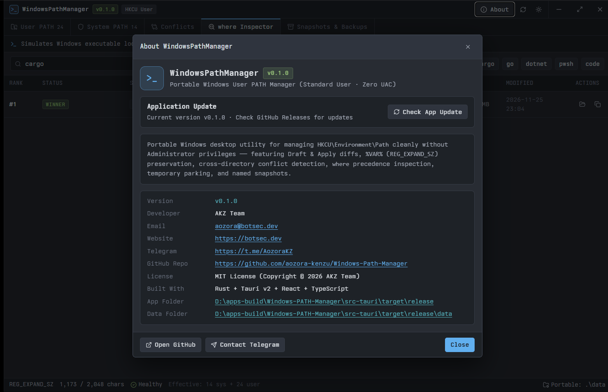

<div align="center">

# `>_` WindowsPathManager

**Portable Windows User `PATH` Manager (`HKCU\Environment\Path`) — No Administrator Rights Required**

[](https://github.com/aozora-kenzu/Windows-Path-Manager/releases/latest)
[](https://github.com/aozora-kenzu/Windows-Path-Manager/releases/latest)
[-56b6c2?style=for-the-badge&logo=windows)](https://github.com/aozora-kenzu/Windows-Path-Manager/releases/latest)
[-e5c07b?style=for-the-badge)](https://github.com/aozora-kenzu/Windows-Path-Manager)
[](https://tauri.app/)
[](LICENSE)

<br />



</div>

---

## Overview

**WindowsPathManager** is a lightweight, single-executable (~4.5 MB) portable desktop utility for safely inspecting, organizing, validating, and debugging your Windows **User `PATH`** (`HKEY_CURRENT_USER\Environment\Path`) as a **standard non-admin user** — with zero installer and zero UAC elevation prompts.

Styled after **[Zed.dev](https://zed.dev)** (One Dark & One Light themes) using the bundled **IoskeleyMono** font, it replaces Windows' cramped legacy Environment Variables dialog with a fast, diff-reviewed, IDE-grade workflow.

---

## Key Features

- **Full User `PATH` CRUD (No Admin Required)** — Add (via text or native Folder Picker), inline edit, delete, drag-and-drop reorder, or move entries up/down to control resolution precedence.
- **Read-Only System `PATH` Reference** — View `HKLM\SYSTEM\CurrentControlSet\Control\Session Manager\Environment\Path` safely to spot overlaps and understand Windows evaluation order.
- **Draft & Apply Mode + Undo/Redo** — Stage edits, bulk changes, and cleanups safely in memory (`Ctrl+Z` / `Ctrl+Y`), review the exact diff (`Added` / `Removed` / `Reordered` / `Parked`) and character length (`> 2,048` / `> 4,096` warnings), then commit with `Ctrl+S`.
- **Automatic `WM_SETTINGCHANGE` Broadcast** — Notifies Windows on Apply so newly opened terminals and apps immediately pick up the updated `PATH` without logging out or restarting.
- **`%VAR%` (`REG_EXPAND_SZ`) Preservation** — Keeps tokens like `%USERPROFILE%\bin` intact in the registry (never downgrading to `REG_SZ`) while showing a live `ExpandEnvironmentStringsW` preview beneath each entry.
- **Validation & 1-Click Clean-up** — Flags missing folders, file-instead-of-directory targets, unresolved `%VAR%` tokens, extra quotes/spaces, exact User/System duplicates, and symlink/junction same-target duplicates, with a 1-click **Clean** button for broken & exact-duplicate entries.
- **Cross-Directory Conflict Detection** — Automatically scans `PATHEXT` executables across System and Draft User `PATH` to detect when two *different* directories ship the same command (e.g. `ffmpeg`, `go`, `python`), supports **Group by Dir** / **By Command** views, filters out Windows built-in aliases (`notepad`) and installer binaries (`unins000`) as toggleable **Noise**, and offers 1-click **Move to Top** / **Park**.
- **`where` Precedence Inspector** — Simulates Windows command resolution (**System `PATH` evaluated before User `PATH`**) using `PATHEXT` to show exact `#1 WINNER` vs `SHADOWED` / `SHADOWED BY SYSTEM` paths, sizes, and timestamps.
- **Temporary Entry Parking** — Toggle any User `PATH` entry off temporarily without deleting it (stored locally in `parked.json` with its preferred index).
- **Bulk Raw Editor & Import/Export** — Edit all paths 1-per-line in a monospace editor, or export/import configurations as **JSON** (Active + Parked) or **TXT** (Merge or Replace Draft).
- **Auto-Backups & Named Snapshots** — Every Apply automatically saves a timestamped backup (retaining the latest 50), alongside Named Snapshots (e.g., *Work*, *Node 26*) with live diffing and 1-click **Restore to Draft**.
- **Portable-First Storage** — Stores `settings.json`, `parked.json`, `backups/`, and `snapshots/` in `./data` beside `WindowsPathManager.exe`, automatically falling back to `%LOCALAPPDATA%\WindowsPathManager\data` if the executable folder is read-only.
- **Built-In GitHub Self-Updater** — Check for new GitHub Releases inside **About** and run **Update & Restart** to atomically swap the portable `.exe` in-place (with PE header validation and rollback safety).

---

## Screenshots

### Cross-Directory Conflict Detector


### `where` Precedence Inspector


### Named Snapshots & Auto-Backups


### About & Portable Self-Updater


---

## Download & Usage

1. Download **`WindowsPathManager.exe`** (standalone) or **`WindowsPathManager-v0.1.0-win-x64-portable.zip`** from [GitHub Releases](https://github.com/aozora-kenzu/Windows-Path-Manager/releases/latest).
2. Extract (if using `.zip`) and place `WindowsPathManager.exe` anywhere (USB drive, `C:\AppPath`, Desktop, etc.) and run it — no installation or Administrator privileges required.
3. Make edits in **User PATH**, inspect changes via **Review & Apply**, and confirm to write `HKCU\Environment\Path` and broadcast `WM_SETTINGCHANGE`.

> **System Requirements:** Windows 10 or Windows 11 (x64) with Microsoft Edge WebView2 Runtime (pre-installed on Windows 11 and modern Windows 10).

---

## Windows Precedence & Safety Notes

- **How Windows Evaluates `PATH`:** Windows always prepends **System `PATH`** (`HKLM`) before **User `PATH`** (`HKCU`). If a binary exists in System `PATH`, a User `PATH` entry with the same command will be marked **`SHADOWED BY SYSTEM`** in **Conflicts** and **where Inspector**.
- **Atomic Self-Update:** When updating via **About -> Update & Restart**, the app downloads the new `.exe` to `WindowsPathManager.exe.new`, verifies the minimum binary size and Windows PE (`MZ`) header, renames the running binary to `.old`, moves `.new` into place, launches the updated executable, and deletes `.old` on startup.

---

## Building from Source

### Prerequisites
- [Rust](https://rustup.rs/) (MSVC toolchain on Windows)
- [Node.js](https://nodejs.org/) (v20+)

### Development & Testing
```powershell
# Install frontend dependencies
npm install

# Run Rust unit tests (registry encoding, validation, storage, conflict detection, updater)
cargo test --manifest-path src-tauri/Cargo.toml

# Type-check frontend
npx tsc --noEmit

# Run in Tauri dev mode
npm run tauri dev
```

### Build Single Portable `.exe`
```powershell
npm run build:portable
```
The compiled portable executable is output to:
`src-tauri/target/release/WindowsPathManager.exe`

---

## Project Structure

```text
Windows-PATH-Manager/
├── public/fonts/               # Bundled IoskeleyMono WOFF2 font family
├── docs/screenshots/           # Application screenshots
├── src/                        # React + TypeScript Zed-themed frontend
│   ├── components/             # TitleBar, UserPathView, SystemPathView, ConflictsView,
│   │                           # WhereInspectorView, SnapshotsBackupsView, AboutModal, Modals, StatusBar
│   ├── hooks/usePathDraft.ts   # Draft state, Undo/Redo stack, diffing & debounced validation
│   ├── styles/                 # IoskeleyMono @font-face, Zed One Dark/Light themes, responsive CSS
│   ├── api.ts                  # Typed Tauri IPC & native dialog wrappers
│   └── types.ts                # Shared TypeScript interfaces
└── src-tauri/                  # Rust + Tauri v2 backend
    └── src/
        ├── main.rs             # Tauri builder, command registration & startup cleanup
        ├── commands.rs         # Async/blocking Tauri IPC command handlers
        ├── registry.rs         # HKCU/HKLM registry R/W, UTF-16LE, ExpandEnvironmentStringsW, WM_SETTINGCHANGE
        ├── validator.rs        # Normalization, duplicate/broken checks, canonical target checks
        ├── inspector.rs        # PATHEXT where lookup, directory peek, cross-dir conflict & noise scanner
        ├── storage.rs          # Portable-first ./data storage, parked.json, backups, snapshots, import/export
        ├── updater.rs          # GitHub Releases API check & atomic PE portable self-updater
        └── models.rs           # Serde IPC data structures
```

---

## Author & Support

- **Developer:** AKZ Team
- **Website:** [https://botsec.dev](https://botsec.dev)
- **Telegram:** [https://t.me/AozoraKZ](https://t.me/AozoraKZ)
- **Email:** [aozora@botsec.dev](mailto:aozora@botsec.dev)
- **Repository:** [https://github.com/aozora-kenzu/Windows-Path-Manager](https://github.com/aozora-kenzu/Windows-Path-Manager)

## License

Licensed under the [MIT License](LICENSE) — Copyright © 2026 AKZ Team.
